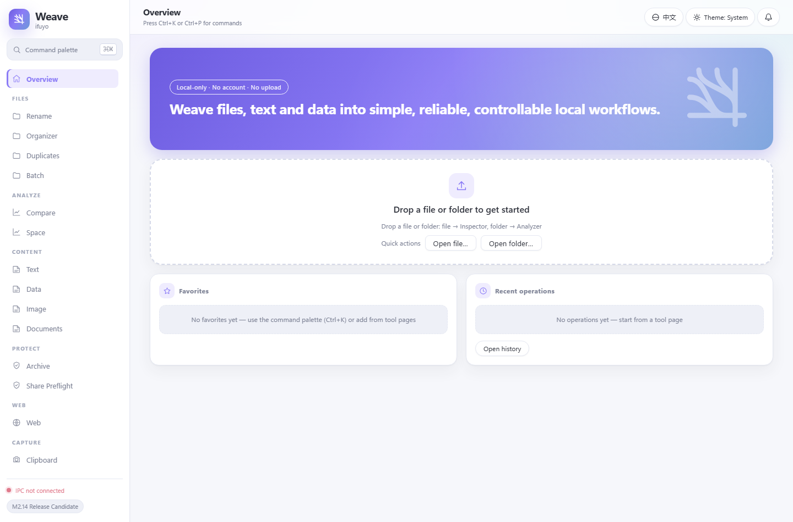

# ifuyo Weave

**English** ｜ [简体中文](README.zh-CN.md)

> Current version **2.0.0-rc.1 (Release Candidate)** · Windows desktop app · MIT OR Apache-2.0

**Weave** is a local-first desktop workbench: a set of carefully crafted tools and automation capabilities for the everyday work of handling files, text, data, documents, media and batch jobs.

> Weave files, text, data and all the small chores into simple, reliable, controllable local workflows.

Weave 2.0 evolves from "software for manually running content-processing tasks" into "a workbench that reliably **analyzes → plans → previews → applies → audits → recovers** and further automates local tasks". The differentiator is not the number of features but a **unified execution model**: every module shares the same Plan / Job / Preview / Undo / Audit machinery — there is no second engine.

The full product constraints live in the repository root document *ifuyo Weave — 开发总纲领 - Project Charter v1.0*.



*Weave 2.0 home view — English UI, light theme. Dark and system-following themes are also available.*

## Philosophy

| Principle | Meaning |
| --- | --- |
| **Local-first** | Files are processed locally; offline by default; no account, no cloud, no telemetry, no upload |
| **Utility-first** | A tool first — visuals serve efficiency |
| **Batch-first** | 1 file and 10,000 files are treated the same way |
| **Preview-first** | Analyze → Preview → Confirm → Apply — explain before acting |
| **Reversible-first** | Undo whenever possible; warn explicitly when not; deletions always go to the OS recycle bin |
| **Honest capability** | Capability matrices state the truth; unsupported, limited or degraded behavior is always surfaced, never silently reported as success |

## The 2.0 Execution Model

```text
Input → Analyze → Plan → Preview / Dry Run → Apply → Audit → Recover / Undo → Report
```

- **Weave Workbench (user-initiated)**: analysis, Preview, Plan, Dry Run, Apply, Recipe, Report, Recovery, task history
- **Weave Agent (background)**: clipboard monitoring, folder watch, scheduler, notifications, background jobs

Both share the same execution foundation — no second Job / Undo / Audit / storage system.

## Feature Map

### Core Tools (1.0 baseline, M0–M11)

| Area | Capabilities |
| --- | --- |
| **Files** | File Inspector, Directory Analyzer (incremental stats / resource guards / cooperative cancel), batch rename (9 rule types), rule-based organizing, duplicate finder (size → partial hash → full SHA-256), recycle bin and Undo |
| **Text (M4)** | Formatter (JSON/XML/YAML/SQL/JS/CSS/Markdown with an honest capability matrix), deterministic Compare, Extractor (8 kinds + user regex, linear engine), Transformer (9 operations), safe write-back (TOCTOU snapshot + backup + atomic replace + history/undo) |
| **Data (M5)** | CSV Studio (paging / filtering / sorting), Data Cleaner (ordered rule plan), JSON ↔ CSV ↔ TSV ↔ JSONL conversion, Data Inspector (inferred types / null rate / exact unique values — honestly `Unavailable` when over the limit) |
| **Images (M6)** | Resize / format conversion / batch processing; boundaries in [docs/IMAGE_FORMATS.md](docs/IMAGE_FORMATS.md) |
| **Documents (M8)** | PDF Inspect / Merge / Split / Extract / Reorder / Rotate (validated output); structured Inspect for DOCX / XLSX / PPTX. Inspect is read-only, output-first writes a new file, batch work goes through the M7 pipeline. No render preview, Office→PDF, encrypted-document unlocking or Office editing — see [docs/DOCUMENTS.md](docs/DOCUMENTS.md) |
| **Batch Engine (M7)** | Unified Linear Pipeline: Preview (same-engine dry run) / Execute / Progress / Cancel / Pause / Resume (journal-driven, crash-recoverable) / Retry Failed / result filtering / History & Undo — see [docs/BATCH_ENGINE.md](docs/BATCH_ENGINE.md) |
| **Utilities (M9)** | Hash (MD5/SHA-1/SHA-2 family/BLAKE3 with weak-algorithm warnings), Checksum (CRC-32/CRC-32C/Adler-32), Base64 (standard/URL-safe, strict decoding), UUID (v4/v7 generation + validation), timestamps (multiple units / RFC 3339 / fixed offsets), URL (component/query semantics + parsing), regex tester, color (HEX/RGB/HSL/HSV/HWB + contrast) — all local, deterministic, structured output |
| **Workflow (M10)** | Linear workflow composition: save / reuse / preview / execute (compiled to the same M7 JobPlan engine); no DAG, scripting or cloud in 2.0 |

### 2.0 Capability Centers (M2.0–M2.15)

| Module | Capabilities |
| --- | --- |
| **M2.0 Foundation** | Formalized unified execution lifecycle contracts; reuses 1.0 infrastructure, no second engine |
| **M2.1 Compare** | Unified diff model; strict separation between read-only analysis and actionable Plan (Copy via the shared executor, Delete via the M3 recycle bin) |
| **M2.2 Space** | Space analysis → locate usage → cleanup candidates → preview → per-item stale revalidation → recycle bin, recoverable. Analysis-first: a candidate is not garbage |
| **M2.3 Clipboard** | Text / image / file clipboard history, search / re-copy, retention policy and privacy boundaries (pause / cap / sensitive marking) |
| **M2.4 Privacy** | Share preflight: three-level evidence Findings → Review → export safe copy (original untouched) → re-scan → Audit |
| **M2.5 Archive** | ZIP create / inspect / safe extract (Zip Slip, reserved names, zip-bomb guards), SHA-256 file verification, directory Manifest |
| **M2.6 Agent** | Sole owner of background lifecycle: seven-state machine, idempotent start/stop, drift-free scheduler, bounded queue, unified notification center |
| **M2.7 Recipe** | Declarative recipes (parameterized step composition) with a complete Manual Trigger loop; a Recipe orchestrates, it is not a second engine |
| **M2.8 Glint** | Screen / window capture, OCR (WinRT), annotation, bounded storage; deletion goes to the recycle bin |
| **M2.9 Wisp** | Paste guard: sensitivity model / rule engine / masking / risk engine; detection capability honestly declared as Limited |
| **M2.10 Web** | URL normalization and cleaning, SSRF-guarded fetching, HTML → Markdown extraction |
| **M2.11 Monitor** | Website change detection: Target / Snapshot / rules / notifications, wired into the Agent Scheduler |
| **M2.12 Smart** | Smart processing suggestions: produces Suggestions only (Advisor/Authority boundary); execution stays in the existing core |
| **M2.13 Unified Experience** | Grouped navigation, Job Center, notification drawer, unified Settings |
| **M2.14 / M2.15** | Product polish (command palette consolidation, actionable empty states, keyboard polish) and final acceptance / version freeze |

## Typical Flows

```text
Text: paste / load → Format → Transform → Extract → Compare
  → Preview (no side effects) → write back (explicit confirm + snapshot check
  + backup + atomic replace + history/undo) → or copy / export
```

```text
Duplicates: drop a folder → Scan (size → partial hash → full SHA-256)
  → review groups → select files to recycle (keep at least one per group)
  → build a recycle plan (Preview) → confirm (explicitly stated: moves to the
  OS recycle bin, reversible) → Recycle → results → History → Undo (restore)
```

Weave makes no "one-click disk cleanup" promises: scan results are facts only, the user decides item by item what to recycle, every group must keep at least one copy, and files modified after the scan are rejected for recycling.

## Interface

- **Sidebar**: brand block, `Ctrl+K` command palette entry, 10 grouped navigation sections (line icons + active highlight), IPC status and milestone footer
- **Top bar**: current view title, version / environment, language (简体中文 / English), theme (light / dark / follow system), notification center
- **Home**: gradient hero, drop zone (file → Inspector, folder → Analyzer), quick open, favorites and recent-operation cards, Quick Drop suggestions
- **Global**: design tokens are the single source of truth in [`ui/src/design/tokens.ts`](ui/src/design/tokens.ts) — bare color literals are forbidden in business code; command palette via `Ctrl+K` / `Ctrl+P`; zh-CN/en i18n key parity; responsive layout and reduced-motion support

## Tech Stack

| Layer | Choice | Version / Notes |
| --- | --- | --- |
| Desktop framework | Tauri 2 | 2.12.x; NSIS installer, tightened CSP |
| Backend | Rust | stable / edition 2024 / msvc; workspace `unsafe_code = "forbid"` |
| Frontend | React + TypeScript + Vite | 19.3 / 5.9 / 8.3 |
| State | Zustand | 5.x |
| IPC types | tauri-specta | 2.0.0-rc.25, generates `ui/src/generated/bindings.ts` |
| Logging | tracing + rolling file | 0.1.x |

> The product version `2.0.0-rc.1` is defined by `Cargo.toml` (workspace) and `src-tauri/tauri.conf.json`; the `0.1.0` in `package.json` is only the private frontend package version, not the product version.

## Development

```powershell
npm install          # frontend dependencies
npm run dev          # frontend only (Vite, :1420)
npm run tauri dev    # full desktop app (first Rust build takes a while)
npm run tauri build  # production build (NSIS installer)
```

Generators:

```text
npm run generate:bindings   # regenerate ui/src/generated/bindings.ts (IPC contract)
npm run generate:icon       # regenerate the placeholder app icon
```

## Quality Gates

CI ([`.github/workflows/ci.yml`](.github/workflows/ci.yml), windows-latest, Rust stable + Node 24) enforces:

```text
cargo fmt --all --check
cargo clippy --workspace --all-targets -- -D warnings
cargo test --workspace
npm run typecheck
npm run lint
npm test
npm run tauri build
cargo deny check licenses
node scripts/check-frontend-licenses.mjs
```

2.0 RC full regression: **42 suites / 778 Rust tests / 0 failures**, **38 vitest** tests on the frontend, `eslint` 0 errors / 0 warnings, NSIS installer 6.67 MiB.

## Repository Layout

```text
crates/           Rust workspace: weave-core + 13 domain crates + weave-testkit (15 total)
src-tauri/        Tauri shell + Application layer (IPC commands, config, logging, Agent)
ui/               React/TS frontend (app/ design/ i18n/ stores/ commands/ features/ generated/)
docs/             Milestone documents (PERF / file-core / text / DATA_FORMATS / IMAGE_FORMATS / BATCH_ENGINE / DOCUMENTS)
Spec/             Milestone development prompts and acceptance reports
scripts/          Tooling (icon generation, license audit)
.github/          CI (windows-latest)
```

## Architecture

```text
UI (React)
 ↓ IPC (typed, generated by tauri-specta)
Application (src-tauri)
 ↓
Core (weave-core: Tool trait / Error / Path Safety / Registry / Plan / Operation)
 ↓
Adapters → OS / File System
```

React components must never touch the filesystem directly. See [ARCHITECTURE.md](ARCHITECTURE.md) and [DECISIONS.md](DECISIONS.md).

## Privacy & Security

No telemetry, no account, no cloud, no upload; all processing happens locally. See [PRIVACY.md](PRIVACY.md) and [SECURITY.md](SECURITY.md).

## Documentation

- [docs/README.md](docs/README.md) — document index
- [docs/file-core.md](docs/file-core.md) · [docs/text.md](docs/text.md) · [docs/DATA_FORMATS.md](docs/DATA_FORMATS.md) · [docs/IMAGE_FORMATS.md](docs/IMAGE_FORMATS.md)
- [docs/DOCUMENTS.md](docs/DOCUMENTS.md) · [docs/BATCH_ENGINE.md](docs/BATCH_ENGINE.md) · [docs/PERF.md](docs/PERF.md)
- [PROGRESS.md](PROGRESS.md) · [CHANGELOG.md](CHANGELOG.md) · [BRAND.md](BRAND.md)

## Current Status

**M0–M11 and M2.0–M2.15 have converged to the 2.0.0-rc.1 Release Candidate** (P1 PARTIAL / Limited items are labeled as such rather than reported as COMPLETE). See [PROGRESS.md](PROGRESS.md).

### Known Limitations (stated honestly; partly tracked as 2.1 backlog)

- Web / Monitor do not support JavaScript-rendered pages or authenticated sessions
- robots awareness, performance benchmark table, ContextActionProvider, Rename alternatives: DEFERRED
- Wisp sensitive-data detection is Limited; Documents has no render preview, Office→PDF, encrypted-document unlocking or Office editing
- Directory Analyzer classifies by extension plus bounded magic sniffing, not full content sniffing (facts first; see [docs/file-core.md](docs/file-core.md))
- The app icon is a script-generated engineering placeholder, not a brand asset (see [BRAND.md](BRAND.md))
- Windows test executables depend on the common-controls manifest injected by build.rs (see [DECISIONS.md](DECISIONS.md) #12)

## License

MIT OR Apache-2.0 (dual license, see [LICENSE-MIT](LICENSE-MIT) / [LICENSE-APACHE](LICENSE-APACHE)); third-party notices in [THIRD_PARTY_LICENSES.md](THIRD_PARTY_LICENSES.md). Brand assets belong to ifuyo and are not covered by the code license.
