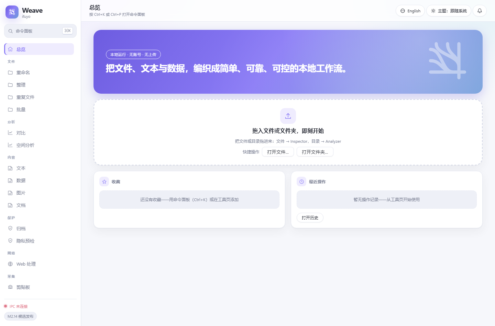

# ifuyo Weave

[English](README.md) ｜ **简体中文**

> 当前版本 **2.0.0-rc.1（Release Candidate）** · Windows 桌面应用 · MIT OR Apache-2.0

**Weave** 是一个 local-first 的桌面工作台：用一组高质量的工具与自动化能力，处理文件、文本、数据、文档、媒体与批处理中的高频杂事。

> 把文件、文本、数据和各种琐碎工作，编织成简单、可靠、可控的本地工作流。

Weave 2.0 从「手动执行各种内容处理任务的软件」升级为「能够可靠地**分析 → 规划 → 预览 → 执行 → 审计 → 恢复**并自动执行本地内容任务的工作台」。核心差异化不是功能数量，而是**统一执行模型**：所有模块共用同一套 Plan / Job / Preview / Undo / Audit，不设第二引擎。

完整产品约束见仓库根目录《ifuyo Weave — 开发总纲领 - Project Charter v1.0》。



*Weave 2.0 主界面（中文界面，浅色主题）；同时提供深色与跟随系统主题。*

## 核心哲学

| 原则 | 含义 |
| --- | --- |
| **Local-first** | 文件本地处理，默认不联网；无账号、无云端、无遥测、无上传 |
| **Utility-first** | 首先是工具，视觉服务于效率 |
| **Batch-first** | 1 个文件和 10,000 个文件同等对待 |
| **Preview-first** | Analyze → Preview → Confirm → Apply，先说明再动手 |
| **Reversible-first** | 能撤销必须撤销；不能撤销的明确警告；删除一律走系统回收站 |
| **Honest capability** | 能力矩阵如实标注；不支持、受限、降级一律明示，绝不静默伪装成功 |

## 2.0 统一执行模型

```text
Input → Analyze → Plan → Preview / Dry Run → Apply → Audit → Recover / Undo → Report
```

- **Weave Workbench（用户发起）**：分析、Preview、Plan、Dry Run、Apply、Recipe、Report、Recovery、历史任务
- **Weave Agent（后台持续）**：剪贴板监听、目录监视、调度器、通知、后台 Job

两者共用同一执行底座，不引入第二套 Job / Undo / Audit / 存储体系。

## 功能地图

### 基础工具（1.0 基线，M0–M11）

| 领域 | 能力 |
| --- | --- |
| **文件** | File Inspector、Directory Analyzer（增量统计 / 资源守卫 / 协作取消）、批量重命名（9 类规则）、规则整理、重复文件查找（size → partial hash → 全量 SHA-256）、回收站与 Undo |
| **文本（M4）** | Formatter（JSON/XML/YAML/SQL/JS/CSS/Markdown，能力矩阵如实标注）、确定性 Compare、Extractor（8 类 + 用户正则，线性引擎）、Transformer（9 操作）、安全写回（TOCTOU 快照 + 备份 + 原子替换 + 历史/撤销） |
| **数据（M5）** | CSV Studio（分页 / 过滤 / 排序）、Data Cleaner（有序规则计划）、JSON ↔ CSV ↔ TSV ↔ JSONL 转换、Data Inspector（潜在类型 / 空值率 / 精确唯一值，超限如实 Unavailable） |
| **图片（M6）** | 缩放 / 格式转换 / 批量处理，能力边界见 [docs/IMAGE_FORMATS.md](docs/IMAGE_FORMATS.md) |
| **文档（M8）** | PDF Inspect / Merge / Split / Extract / Reorder / Rotate（输出经校验）；DOCX / XLSX / PPTX 结构化 Inspect。Inspect 只读、output-first 写新文件、批量经 M7 Pipeline；不支持渲染预览、Office→PDF、加密解锁、Office 编辑，详见 [docs/DOCUMENTS.md](docs/DOCUMENTS.md) |
| **批处理（M7）** | 统一 Linear Pipeline：Preview（同引擎 dry-run）/ Execute / Progress / Cancel / Pause / Resume（journal 驱动，崩溃可恢复）/ Retry Failed / 结果过滤搜索 / History & Undo，详见 [docs/BATCH_ENGINE.md](docs/BATCH_ENGINE.md) |
| **工具集（M9）** | Hash（MD5/SHA-1/SHA-2 族/BLAKE3，弱算法提示）、Checksum（CRC-32/CRC-32C/Adler-32）、Base64（标准/URL-safe，严格解码）、UUID（v4/v7 生成+校验）、时间戳（多单位/RFC 3339/固定偏移）、URL（Component/Query 语义分离+解析）、正则测试、颜色（HEX/RGB/HSL/HSV/HWB+对比度）——全部本地、确定性、结构化输出 |
| **工作流（M10）** | 线性工作流组合：保存 / 复用 / 预览 / 执行（编译为 M7 JobPlan 同引擎执行）；2.0 无 DAG / 脚本 / 云 |

### 2.0 能力中心（M2.0–M2.15）

| 模块 | 能力 |
| --- | --- |
| **M2.0 Foundation** | 统一执行生命周期契约正式化；复用 1.0 设施，无第二引擎 |
| **M2.1 Compare** | 统一差异模型；只读分析与可执行 Plan（Copy 走共享执行器、Delete 复用 M3 回收站）严格分离 |
| **M2.2 Space** | 空间分析 → 占用定位 → 清理候选 → 预览 → 逐项 stale 重验 → 回收站，可恢复；Analysis-first，候选 ≠ 垃圾 |
| **M2.3 Clipboard** | 文本 / 图片 / 文件剪贴板历史、搜索 / 重复制、保留策略与隐私边界（暂停 / 上限 / 敏感标记） |
| **M2.4 Privacy** | 分享前隐私预检：三级证据 Findings → Review → 导出安全副本（原文件零接触）→ 复扫 → Audit |
| **M2.5 Archive** | ZIP 创建 / 检查 / 安全解压（Zip Slip、保留名、压缩炸弹防护）、SHA-256 文件校验、目录 Manifest |
| **M2.6 Agent** | 后台生命周期唯一主人：七态状态机、幂等启停、无漂移调度器、有界队列、统一通知中心 |
| **M2.7 Recipe** | 声明式配方（参数化步骤组合）与 Manual Trigger 闭环；Recipe 是编排者，不是第二个执行引擎 |
| **M2.8 Glint** | 屏幕 / 窗口截图、OCR（WinRT）、标注、有界存储；删除走回收站 |
| **M2.9 Wisp** | 粘贴防护：敏感度模型 / 规则引擎 / 脱敏 / 风险引擎；检测能力 Limited 如实声明 |
| **M2.10 Web** | URL 规范化与清理、SSRF 防护抓取、HTML → Markdown 提取 |
| **M2.11 Monitor** | 网站变化检测：Target / Snapshot / 规则 / 通知，接入 Agent Scheduler |
| **M2.12 Smart** | 智能处理建议：仅产出 Suggestion（Advisor/Authority 边界），执行仍交既有核心 |
| **M2.13 Unified Experience** | 分组导航、Job Center、通知抽屉、统一 Settings |
| **M2.14 / M2.15** | 产品打磨（命令面板收口、空态可操作化、键盘 polish）与最终验收定版 |

## 典型流程

```text
文本：粘贴 / 加载 → Format → Transform → Extract → Compare
  → Preview（无副作用）→ 写回（显式确认 + 快照校验 + 备份 + 原子替换 + 历史/撤销）
  → 或复制 / 导出
```

```text
重复文件：拖入目录 → Scan（size → partial hash → full SHA-256）
  → 按组查看 → 勾选要回收的文件（每组至少保留一份）
  → 生成回收计划（Preview）→ 确认（明确告知：移入系统回收站，可撤销）
  → Recycle → 结果统计 → History → Undo（从回收站还原）
```

Weave 不做「一键清理磁盘」式承诺：扫描结果只是事实，回收什么由用户逐项决定；每组必须保留至少一份；扫描后被改动的文件会被拒绝回收。

## 界面

- **侧栏**：品牌区、`Ctrl+K` 命令面板入口、10 组分组导航（线性图标 + 当前项高亮）、IPC 状态与里程碑页脚
- **顶栏**：当前视图标题、版本 / 环境、语言（简体中文 / English）、主题（浅色 / 深色 / 跟随系统）、通知中心
- **首页**：渐变 hero、拖放区（文件 → Inspector，目录 → Analyzer）、快捷打开、收藏与最近操作卡片、Quick Drop 建议
- **全局**：设计令牌单一事实源 [`ui/src/design/tokens.ts`](ui/src/design/tokens.ts)，业务代码禁止裸色值；命令面板 `Ctrl+K` / `Ctrl+P`；i18n 中英键集对等；响应式布局与 reduced-motion 支持

## 技术栈

| 层 | 选型 | 版本 / 说明 |
| --- | --- | --- |
| 桌面框架 | Tauri 2 | 2.12.x；NSIS 安装包，收紧 CSP |
| 后端 | Rust | stable / edition 2024 / msvc；workspace `unsafe_code = "forbid"` |
| 前端 | React + TypeScript + Vite | 19.3 / 5.9 / 8.3 |
| 状态 | Zustand | 5.x |
| IPC 类型 | tauri-specta | 2.0.0-rc.25，生成 `ui/src/generated/bindings.ts` |
| 日志 | tracing + rolling file | 0.1.x |

> 产品版本 `2.0.0-rc.1` 由 `Cargo.toml`（workspace）与 `src-tauri/tauri.conf.json` 定版；`package.json` 中的 `0.1.0` 只是前端私有包版本，不是产品版本。

## 开发

```powershell
npm install          # 前端依赖
npm run dev          # 仅前端（Vite, :1420）
npm run tauri dev    # 完整桌面应用（首次 Rust 编译较久）
npm run tauri build  # 生产构建（NSIS 安装包）
```

生成类命令：

```text
npm run generate:bindings   # 重新生成 ui/src/generated/bindings.ts（IPC 契约）
npm run generate:icon       # 重新生成占位应用图标（scripts/generate-icon.mjs）
```

## 质量门

CI（[`.github/workflows/ci.yml`](.github/workflows/ci.yml)，windows-latest，Rust stable + Node 24）强制：

```text
cargo fmt --all --check
cargo clippy --workspace --all-targets -- -D warnings
cargo test --workspace
npm run typecheck
npm run lint
npm test
npm run tauri build
cargo deny check licenses
node scripts/check-frontend-licenses.mjs
```

2.0 RC 全量回归：**42 套件 / 778 项 Rust 测试 / 0 失败**，前端 **38 项 vitest**，`eslint` 0 错误 0 警告，NSIS 安装包 6.67 MiB。

## 仓库结构

```text
crates/           Rust workspace：weave-core + 13 个领域 crate + weave-testkit（共 15 个）
src-tauri/        Tauri 壳 + Application 层（IPC 命令、配置、日志、Agent）
ui/               React/TS 前端（app/ design/ i18n/ stores/ commands/ features/ generated/）
docs/             里程碑专项文档（PERF / file-core / text / DATA_FORMATS / IMAGE_FORMATS / BATCH_ENGINE / DOCUMENTS）
Spec/             各里程碑开发提示词与验收报告
scripts/          工具脚本（图标生成、license 审计）
.github/          CI（windows-latest）
```

## 架构

```text
UI (React)
 ↓ IPC（typed，tauri-specta 生成）
Application (src-tauri)
 ↓
Core (weave-core: Tool trait / Error / Path Safety / Registry / Plan / Operation)
 ↓
Adapters → OS / File System
```

禁止 React 组件直接触碰文件系统。详见 [ARCHITECTURE.md](ARCHITECTURE.md) 与 [DECISIONS.md](DECISIONS.md)。

## 隐私与安全

无遥测、无账号、无云端、无上传；所有处理在本地完成。详见 [PRIVACY.md](PRIVACY.md) 与 [SECURITY.md](SECURITY.md)。

## 文档

- [docs/README.md](docs/README.md) — 文档索引
- [docs/file-core.md](docs/file-core.md) · [docs/text.md](docs/text.md) · [docs/DATA_FORMATS.md](docs/DATA_FORMATS.md) · [docs/IMAGE_FORMATS.md](docs/IMAGE_FORMATS.md)
- [docs/DOCUMENTS.md](docs/DOCUMENTS.md) · [docs/BATCH_ENGINE.md](docs/BATCH_ENGINE.md) · [docs/PERF.md](docs/PERF.md)
- [PROGRESS.md](PROGRESS.md) · [CHANGELOG.md](CHANGELOG.md) · [BRAND.md](BRAND.md)

## 当前状态

**M0–M11 与 M2.0–M2.15 已收口至 2.0.0-rc.1 Release Candidate**（P1 PARTIAL / Limited 项按事实标注，不伪装 COMPLETE）。详见 [PROGRESS.md](PROGRESS.md)。

### 已知限制（如实声明，部分列入 2.1 Backlog）

- Web / Monitor 不支持 JS 渲染页面与登录态
- robots awareness、性能基准表、ContextActionProvider、Rename alternatives：DEFERRED
- Wisp 敏感信息检测能力 Limited；Documents 不支持渲染预览、Office→PDF、加密文档解锁、Office 编辑
- Directory Analyzer 按扩展名 + 有限 magic 嗅探分类，不做完整内容嗅探（事实优先，见 [docs/file-core.md](docs/file-core.md)）
- 应用图标为脚本生成的工程占位，非品牌资产（见 [BRAND.md](BRAND.md)）
- Windows 测试可执行文件依赖 build.rs 注入的 common-controls manifest（见 [DECISIONS.md](DECISIONS.md) #12）

## 许可

MIT OR Apache-2.0（双许可，见 [LICENSE-MIT](LICENSE-MIT) / [LICENSE-APACHE](LICENSE-APACHE)）；第三方许可见 [THIRD_PARTY_LICENSES.md](THIRD_PARTY_LICENSES.md)。品牌资产归 ifuyo 所有，代码许可不覆盖品牌。
